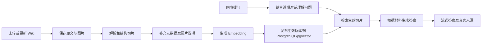

# lishouAgent 迁移与开发计划

> 本文件是项目需求、技术决策、开发任务和进度记录的统一入口。后续每次开发均需先阅读本文件，并在结束、交接或产生重要进展时同步更新对应任务、验收结果和进度日志。

- 创建日期：2026-10-04
- 最近更新：2026-10-26
- 时间基准：Asia/Shanghai（北京时间）
- 当前阶段：M0、M1 已完成；M2-01、M2-02 已通过本机验收，下一步继续 M2-03 结构切片和后续上传发布链路；M2/M4 三组定向复问的核心事实与关键引用已通过，仍有层级计数和完整功能待验证
- 源项目：`D:\Coding\Java-learn\brownie-ai-agent`
- 目标项目：`D:\Coding\Java-learn\lishouAgent`
- 目标仓库：`https://github.com/brownieya/lishouAgent.git`
- 新项目包名：`com.brownie.lishouagent`；数据库：`lishou_agent`；后端端口：`8124`
- 首批知识资料：`D:\Coding\Java-learn\brownie-ai-agent\lishou-private-data-含图片`

## 1. 项目目标与已确定范围

lishouAgent 是面向公司同事的内部 Wiki 知识助手，用于了解公司项目、系统用途、项目关系、业务流程、操作方法和技术文档。回答需要有可核实的文档来源；资料不足时明确说明，不编造公司事实。

已确定的使用条件：

1. 公司约十多人，知识文档全员可查看、编写；第一版采用一个共享知识库。
2. Wiki 可导出文件，第一版采用手动上传和更新，不依赖在线 Wiki 平台连接器。
3. 首批资料已检查：10 篇 Markdown、4 张 PNG、1 张 JPG；10 篇均有正文；5 处图片引用均能找到本地文件。导出目录本身不证明覆盖了全部业务或所有资料均为最新。
4. PostgreSQL 同时保存普通业务数据与向量数据；使用 pgvector 扩展进行知识检索。
5. 完整会话和消息持久化到数据库；知识全员共享，个人聊天按用户隔离。
6. 第一版包含聊天页面、历史会话、知识库管理页面、文档上传切片、切片编辑与重新索引、回答引用、图片资料保留、增量更新和 Docker Compose 部署。
7. Thinking 是可选增强能力，不是开启 RAG 或 ReAct 的前提，也不阻塞核心第一版验收。

### 1.1 第一版必须交付

- 有来源的 Wiki 问答和多轮追问。
- 新建、切换、重命名、删除会话；刷新后恢复历史消息。
- 文档列表、分类、原文预览、切片列表、处理状态和错误信息。
- Markdown 与包含 Markdown/图片目录的 ZIP 导入；保留原目录关联和图片引用。
- 切片编辑、删除或停用，保存后重新向量化；失败时保留旧生效版本。
- 文档去重、版本更新、删除与关联向量清理。
- 当前 5 张图片的关键内容文字化，并能查看原图。
- 基础用户身份、会话归属校验、编辑者和上传者记录。
- 数据库及原文件持久化、备份恢复说明、真实业务问题验收。

### 1.2 后续增强

- Thinking 开关、思考事件展示及 Token/延迟记录。
- HTML、PDF 导入，OCR 或视觉模型辅助理解图片。
- 切片合并、拆分、批量编辑、版本回退。
- 项目简称/别名词典、关键词与向量混合检索、重排序。
- 自动同步 Wiki、用户反馈统计、跨系统只读查询工具。

第一版不要求多智能体、复杂部门权限、自动办事、任意终端执行、外网搜索、Redis、消息队列、Kubernetes 或模型微调。

## 2. 当前项目基线

以下结论来自本地代码检查，不代表已查询生产数据库或已通过端到端运行验证。

| 模块 | 当前状态 | 迁移影响 |
| --- | --- | --- |
| 后端 | Java 21、Spring Boot 3.5.16 | 保留基础框架，新增公司知识业务 |
| AI 接入 | Spring AI Alibaba 1.1.2.0；部分 Spring AI 组件为 1.1.2；DashScope | 新增依赖与现有兼容版本对齐，不顺带升级主版本 |
| LoveApp | 恋爱角色、基础聊天、流式聊天、会话记忆 | 改造成公司知识助手服务 |
| RAG | 已有文档加载、查询改写、检索增强；当前 RAG 方法未接入页面聊天，并固定“单身”过滤 | 必须重新接通 RAG 流式链路，去掉恋爱过滤 |
| 向量库 | 同时存在内存 SimpleVectorStore、PostgreSQL pgvector、百炼云知识库配置 | 第一版统一为 PostgreSQL＋pgvector，移除重复方案及强制注入 |
| 文档来源 | `classpath:document/*.md` 下的恋爱文档 | 改为可配置的外部文件存储与用户触发的导入服务 |
| pgvector 入库 | Bean 初始化时加载全部文档并 add | 应用启动不再重新导入所有文档 |
| 恋爱会话记忆 | 当前启用本地 `.kryo` 文件，内存实现已注释；使用有限消息窗口 | 改为数据库历史记录与模型上下文管理 |
| 前端 | Vue 3＋Vite；首页、LoveApp、Manus；真实 SSE 调用 | 保留聊天组件，新增会话侧栏和知识管理界面 |
| 前端会话 | 页面内存保存消息；每次进入生成新 chatId | 接入后端会话记录，恢复已有会话 ID |
| Manus | ReAct 式工具循环和 Step 输出 | 第一版移除相关业务入口和工具依赖 |
| Thinking | 尚未显式启用，也未单独传输 reasoning 字段 | 增强阶段按请求参数实现 |
| 部署 | 已有后端 Dockerfile 和生产配置 | 补充前端镜像、pgvector 数据库、Compose、卷与备份 |

## 3. 迁移清单

### 3.1 保留并改造

| 内容 | 迁移方式 |
| --- | --- |
| Maven、Java 21、Spring Boot | 保留构建能力，改项目标识、包结构和配置示例 |
| DashScope ChatModel、ChatClient | 保留模型接入；区分聊天模型、Embedding 模型和配置 |
| LoveApp 基础对话 | 迁移为公司知识服务，建议命名 `LishouAssistantService` |
| MessageChatMemoryAdvisor 的上下文能力 | 与数据库会话读取结合；不将有限窗口作为完整聊天历史 |
| RAG 文档处理、查询改写、检索组件 | 改造标题/步骤切片、项目元数据和多轮检索 |
| PostgreSQL JDBC 和 pgvector | 保留，使用单一数据源管理业务表与向量表 |
| Vue 聊天组件、路由、输入、滚动与流式显示 | 改成 lishouAgent 页面并接入新的事件协议 |
| 健康检查、日志、错误处理、测试基础 | 保留有用部分，调整公司知识场景与日志内容 |
| Dockerfile 和生产环境配置思路 | 改为新项目名称、环境变量和多容器部署 |

### 3.2 删除或不迁入第一版

- 恋爱系统提示词、恋爱示例知识文档、LoveReport 和恋爱场景测试。
- 内存向量库与百炼云知识库作为默认依赖的配置。
- Manus 页面、业务 Controller 入口、ReAct 工具注册及第一版不用的 Agent 类。
- 任意终端执行、文件读写工具、外网搜索、网页抓取、资源下载、PDF 生成、任务终止工具。
- 图片搜索 MCP 子项目、MCP 默认依赖与闲置配置。
- 与最终产品无关的模型调用演示、旧项目笔记和示例测试。
- 前端双应用选择入口；改为聊天和知识库管理的导航。

工具代码如需保留学习参考，继续保留在原项目，避免新服务因未使用的 Bean、密钥或外部服务而启动失败。

### 3.3 迁移操作约定

1. 保留原项目，迁移开发在目标目录独立进行。
2. 基于当前源代码内容迁移；源项目存在的未提交改动先核对，避免只复制 Git HEAD 而漏掉有效配置，也不修改或重置原项目。
3. 不复制旧 `.git`、`target`、`node_modules`、`dist`、临时生成文件、聊天记忆文件及真实密钥。
4. 创建独立 Git 仓库，编写 README、配置模板和忽略规则；内部 Wiki 原文、图片及含内部资料的压缩包不提交到代码仓库。
5. 迁移后验证依赖、包名、入口类、接口路径、前端 API 地址和镜像名称均已更新。
6. 为后续自动维护进度，在目标项目建立 `AGENTS.md`，要求开发前阅读本计划、结束前更新本计划。

## 4. 功能设计与验收要求

### 4.1 共享知识问答

- 查询项目用途、项目关系、业务流程、操作步骤和接口说明。
- 允许选择项目分类缩小检索范围，默认检索共享知识库。
- 用户追问时，用近期上下文补全“这个项目”“第二步”等检索条件；保留原问题用于生成回答。
- 查询改写不应改变项目名称、接口名和公司专有术语。
- 回答依据检索资料；找不到时说明资料不足，问题有歧义时追问。
- 文档冲突时展示差异、来源和已知版本时间，不自行确定未记载的公司规定。

验收：使用真实问题验证检索到了正确文档，回答包含准确步骤与真实引用；无资料、歧义、多轮追问和冲突场景均有合理表现。

### 4.2 会话与用户

- 基础登录；所有用户具有相同的共享知识维护能力。
- 每个会话归属于一个用户，后端校验查询、发送、重命名和删除操作的归属。
- 会话列表、消息分页、刷新恢复、新建与删除。
- 持久化完整用户消息和 AI 答案，记录生成中、完成、失败或中断等状态。
- 模型上下文按窗口或 Token 预算选取；窗口裁剪不删除完整历史消息。
- 保存答案引用快照，后续文档更新或删除时仍能说明当时引用的来源。

验收：两名用户可以同时使用，不能读取对方聊天；重启后会话可恢复；长会话仍保留历史，但模型输入有可控大小。

### 4.3 文档上传与处理

- 第一版支持 Markdown 和含 Markdown/图片目录的 ZIP；可批量导入。
- 保留文档与图片相对路径；存储使用稳定 ID，避免同名覆盖。
- 可填写项目分类、文档标题和原始 Wiki 链接；没有 Wiki 链接时使用导入文件预览。
- 校验文件类型、大小和 ZIP 路径，防止解压目录越界。
- 导入采用后台任务，页面可查询解析、切片、向量化、完成、失败等状态和进度。
- 原文件、图片和解析后的结果分别可追溯；导入失败可重试。
- 进程重启后识别未完成任务，标记为中断并允许重试，不显示虚假的完成状态。

验收：现有资料可完整导入，图片关联不丢失；错误文件有明确提示；重复导入不会产生重复生效切片。

### 4.4 切片规则与切片管理

- 按标题层级、主题和完整业务步骤组织切片；必要时使用长度上限和重叠策略。
- 避免将一个完整操作步骤、表格或代码示例切断；切片携带项目名和章节上下文。
- 切片大小、重叠和检索参数配置化，通过真实问题调试，不沿用恋爱库参数作为结论。
- 管理页面展示切片列表、所属文档、章节、正文、原始内容、人工编辑标记和状态。
- 支持编辑、删除或停用；编辑者与修改时间可查。
- 编辑使用版本检查，避免多人同时编辑时无提示覆盖。
- 编辑产生新版本并重新计算向量；新版本成功索引后生效，失败时旧版本继续用于检索。
- 文本、向量和生效版本需一致；Embedding 调用与正式发布分别处理，不允许“新正文＋旧向量”。

验收：编辑后使用相关问题检索，命中新版内容；Embedding 失败时旧版仍可用；停用或删除的切片不再命中。

### 4.5 文档版本、去重和删除

- 以稳定文档 ID、内容哈希和版本记录识别未变化、更新或重复内容。
- 更新文档时先处理新版本，成功后统一切换生效版本，避免新旧切片混用。
- 人工修改与原始 Wiki 内容分别保留；重新导入发生冲突时提示处理，不静默覆盖。
- 删除文档同步停用或清理有效切片、向量和相关检索数据。
- 原始资料更新是业务事实变更的来源；人工切片编辑用于整理上下文，不暗示原 Wiki 已修改。

验收：同一文档重复导入后只有一套生效内容；更新失败保留旧版；删除后无法检索到该文档。

### 4.6 来源与图片

- 答案引用来自真实检索记录，不能由模型自由生成文档链接。
- 展示文档标题、章节、来源地址、版本或已知更新时间；时间未知时不伪造 Wiki 更新时间。
- 可查看相关原文和图片；人工整理的片段显示修改信息。
- 为现有 5 张图片逐张判断用途；关键流程图、截图人工补充文字说明，并与原文、图片 ID 关联后参与文本检索。
- 原图保留供同事核对；展示图片与理解图片是两个独立能力。

验收：引用可打开对应材料；涉及图片的信息能通过说明检索；没有文字化的图片内容不声称已覆盖。

### 4.7 可选 Thinking 增强

- 选择支持 Thinking 的模型版本，按请求传递 `thinking` 开关。
- 当前 Spring AI Alibaba 1.1.2.0 支持 `DashScopeChatOptions.builder().enableThinking(...)`，可选 `thinkingBudget(...)`。
- 使用 `.stream().chatResponse()`，思考内容读取 AssistantMessage metadata 的 `reasoningContent`，最终答案读取 `getText()`。
- 通过独立事件展示供应商允许展示的思考内容或摘要；普通回答区域与思考区域分别处理。
- 记录 Token 消耗、延迟和中断情况，设置可配置的预算和超时。
- Thinking 与 ReAct 区分：开启模型推理不要求恢复原项目 Manus 工具循环。

验收：开关实际传到模型请求；前端事件分流正确；所选模型的支持范围经过真实调用验证。

## 5. 技术方案

### 5.1 推荐技术栈

| 用途 | 技术 | 状态/说明 |
| --- | --- | --- |
| 后端 | Java 21＋Spring Boot | 复用当前兼容版本 |
| 模型与 RAG | Spring AI Alibaba、ChatClient、DashScope、检索增强组件 | 复用，重建公司知识链路 |
| 数据库 | PostgreSQL＋pgvector | 一套数据库，业务表与向量表分工 |
| 数据访问 | 现有 JdbcTemplate；Flyway 管理结构迁移 | 新增业务存取和迁移脚本 |
| 模型上下文 | 自定义历史读取/窗口；可辅以 JDBC ChatMemory | 不与完整消息存档混淆 |
| 文档处理 | MarkdownDocumentReader＋自定义结构切片 | 第一版先支持实际资料格式 |
| 前端 | Vue 3＋Vite＋Vue Router＋现有组件 | 新增知识库管理和会话侧栏 |
| 页面预览 | Markdown 解析、HTML 净化和安全图片地址 | 新增；库版本在实际选型时记录 |
| HTTP | Axios 处理普通接口；fetch 消费 POST SSE | 将对话内容放请求体，支持取消请求 |
| 登录 | Spring Security 或公司已有身份入口 | 默认简单账号方案，不建设复杂角色权限 |
| 后台任务 | Spring 线程池＋PostgreSQL 任务记录 | 第一版无需消息队列 |
| 文件存储 | 配置化服务器目录/持久化卷 | 保存原文和图片；数据库保存关联 |
| 部署 | Docker Compose＋Nginx＋后端＋pgvector 数据库 | 服务各用独立容器 |

新增依赖的版本必须与当前 Spring Boot / Spring AI 组合兼容。升级主版本如确有必要，需要在本计划记录原因、影响和验证结果。

### 5.2 两条处理链路



### 5.3 业务数据设计

下表是逻辑实体，实际建表时根据接口与查询需求确定字段、索引和约束，并通过 Flyway 管理。

| 实体/建议表名 | 主要内容 |
| --- | --- |
| `app_user` | 用户身份、凭据摘要或外部身份、状态 |
| `chat_session` | 用户、标题、创建/更新时间、状态 |
| `chat_message` | 会话、角色、正文、顺序、时间、生成状态 |
| `chat_message_source` | 回答引用的文档/章节/版本快照 |
| `knowledge_document` | 稳定文档 ID、标题、项目、来源、当前生效版本 |
| `knowledge_document_version` | 文件位置、内容哈希、版本、解析与发布时间 |
| `knowledge_asset` | 图片 ID、所属文档版本、文件位置、说明 |
| `knowledge_upload`、`knowledge_upload_file` | 上传原包、暂存 Markdown/图片清单及 ZIP 相对路径；发布前不进入检索 |
| `knowledge_chunk` | 稳定切片标识、所属文档/章节、当前生效修订、启用状态 |
| `knowledge_chunk_revision` | 原始/人工内容、修订号、修改者、状态及索引信息 |
| `vector_store` | 对应生效切片修订的正文、metadata、embedding |
| `ingest_task` | 文档导入或重新索引任务、阶段、进度、错误及重试信息 |

向量记录通过 ID 或 metadata 关联切片修订，保留文档、项目、标题、章节、来源、版本等元数据。检索只使用启用且生效的内容。Embedding 模型或维度变更时需要重新索引，不能直接混用不同模型生成的向量。

### 5.4 接口与流式协议

基础接口分组：

- 身份：空库启动创建默认账号、登录、退出、当前用户、已登录账号维护。
- 会话：列表、新建、重命名、删除、分页读取消息。
- 问答：向某个会话发送消息，通过 POST SSE 返回结果。
- 文档：分页列表、详情、原文预览、上传、重新导入、版本与删除。
- 切片：按文档查询、详情、编辑并重新索引、停用/启用、删除。
- 图片：查看原图、查看或编辑文字说明。
- 任务：状态、进度、错误、失败重试。

SSE 至少区分 `answer`、`sources`、`done`、`error`，可选 `status` 和 `thinking`。约定统一数据格式、结束信号和错误语义；前端不能把断线自动当作成功，完成或失败后关闭连接。

### 5.5 部署与持久化

- 一台服务器运行 Nginx、Spring Boot 和 PostgreSQL＋pgvector 三个容器，使用 Docker Compose 管理。
- 后端通过 Compose 服务名连接数据库，不使用后端容器自己的 localhost。
- PostgreSQL 数据目录、原始 Wiki 和图片目录挂载持久化卷或明确的主机目录。
- 密钥和数据库连接信息放环境变量或部署配置，不进入源代码或镜像；空库启动自动创建固定初始账号，开放服务前必须修改初始密码。
- 前端、后端、模型请求和长时间 SSE 的超时配置相互匹配。
- 提供数据库与原始资料的备份/恢复步骤，至少执行一次恢复验证。
- 持久化卷保证容器重建后保留数据，不能代替备份；数据库大版本升级单独制定迁移步骤。

## 6. 完整开发计划

任务状态统一使用：`待开始`、`进行中`、`待验证`、`已完成`、`阻塞`、`延期`。只有验收通过才能标记为已完成。阶段状态与任务状态必须保持一致。

### M0：代码迁移与工程整理

依赖：无。当前状态：已完成。

| 任务 ID | 工作内容 | 状态 |
| --- | --- | --- |
| M0-01 | 核对源项目改动、创建独立仓库、复制需要的源码与配置模板 | 已完成 |
| M0-02 | 更新项目名、包名、入口类、接口路径及前端标识 | 已完成 |
| M0-03 | 清理恋爱业务、Manus、闲置工具、MCP 和重复向量库依赖 | 已完成 |
| M0-04 | 编写 README、忽略规则、配置示例和引用本计划的 AGENTS.md | 已完成 |
| M0-05 | 验证后端编译/基础启动与前端构建，记录环境和结果 | 已完成 |

交付：能独立构建的 lishouAgent 工程，不依赖原项目临时文件和学习服务。

验收：原项目改动保持原样；目标项目包名和配置一致；真实密钥和内部资料只迁入忽略的本地目录、不进入 Git 或镜像；构建结果有记录。无真实模型/数据库的编译与单元测试不等于端到端验收。

### M1：数据库、身份与持久化基础

依赖：M0。当前状态：已完成。

| 任务 ID | 工作内容 | 状态 |
| --- | --- | --- |
| M1-01 | 确定核心字段、关系、索引和状态，创建 Flyway 脚本 | 已完成 |
| M1-02 | 配置 PostgreSQL＋pgvector，验证扩展及 Embedding 维度 | 已完成 |
| M1-03 | 实现基础身份入口、初始化方式与会话归属校验 | 已完成 |
| M1-04 | 实现会话/消息存取接口与完整消息持久化 | 已完成 |
| M1-05 | 建立配置化文件存储、任务记录和后台执行基础 | 已完成 |

交付：业务数据层、身份层和后台任务基础。

验收：数据库重启后数据存在；两用户会话隔离；迁移脚本可用于空库初始化；本地后台导入任务完成后经后端重启仍可查询。上述项目均已通过本机验证或用户本机反馈；上传、ZIP、逐批进度及运行中任务的真实中断恢复属于后续阶段。

### M2：Wiki 导入、图片关联与自动切片

依赖：M1。当前状态：进行中（先修复基线问答暴露的切片边界问题）。

| 任务 ID | 工作内容 | 状态 |
| --- | --- | --- |
| M2-01 | 实现 Markdown/ZIP 上传、文件存储与路径校验 | 已完成 |
| M2-02 | 解析标题、表格、步骤和代码；建立文档/图片关联 | 已完成 |
| M2-03 | 实现结构切片和可配置长度策略，保留来源元数据 | 进行中 |
| M2-04 | 实现分批 Embedding、任务进度、失败记录与重试 | 待开始 |
| M2-05 | 实现稳定文档 ID、哈希去重、新版本发布及旧版本替换 | 待开始 |
| M2-06 | 导入现有 10 篇文档，逐张处理 5 张图片的说明 | 待开始 |

交付：可通过接口完成资料导入并检索的共享知识库。

验收：资料数量与关联可核对；重复导入无重复生效内容；关键图片信息有说明；导入失败不破坏旧版本。

### M3：知识库页面与切片人工维护

依赖：M2；页面框架可在 M1 期间并行准备。当前状态：待开始。

| 任务 ID | 工作内容 | 状态 |
| --- | --- | --- |
| M3-01 | 文档列表、分类/搜索、详情、原文及图片预览 | 待开始 |
| M3-02 | 上传入口、任务进度、错误信息与重试操作 | 待开始 |
| M3-03 | 文档切片列表、正文预览、原始/人工内容对照 | 待开始 |
| M3-04 | 切片编辑、版本校验、重新索引与成功后生效 | 待开始 |
| M3-05 | 切片停用/删除，文档更新/删除及关联清理 | 待开始 |
| M3-06 | 人工修改标记、编辑者记录及重新导入冲突处理 | 待开始 |

交付：同事可通过页面维护知识，无需直接修改数据库。

验收：修改内容完成向量更新后可检索；失败保留旧版；并发编辑有明确反馈；删除和停用立即退出检索。

### M4：RAG、多轮问答与聊天界面

依赖：M1、M2；可与 M3 部分并行。当前状态：进行中（先修复基线追问的接口定位问题）。

| 任务 ID | 工作内容 | 状态 |
| --- | --- | --- |
| M4-01 | 替换系统提示词，接通 pgvector 检索和流式回答 | 待开始 |
| M4-02 | 结合对话上下文理解追问，保留公司术语与原问题 | 进行中 |
| M4-03 | 从真实检索记录生成来源引用和快照 | 进行中 |
| M4-04 | 统一 SSE 协议，处理错误、结束和用户取消 | 进行中 |
| M4-05 | 聊天页、会话侧栏、刷新恢复、来源卡片和复制回答 | 进行中 |
| M4-06 | 处理资料不足、歧义、冲突和文档已更新/删除的展示 | 待开始 |

交付：具备完整会话和有来源回答的 lishouAgent。

验收：实际问题获得准确引用；追问能找到正确项目；刷新和后端重启后会话可恢复；取消和错误状态准确。

### M5：质量验证、参数调整与运行完善

依赖：M3、M4。当前状态：待开始。

| 任务 ID | 工作内容 | 状态 |
| --- | --- | --- |
| M5-01 | 建立约 30–50 道真实业务问题及参考来源 | 待开始 |
| M5-02 | 验证检索、回答、引用、多轮、无答案及文档冲突表现 | 待开始 |
| M5-03 | 验证导入去重、编辑索引失败、更新删除、并发和重启恢复 | 待开始 |
| M5-04 | 根据失败案例调整切片与检索参数，记录前后结果 | 待开始 |
| M5-05 | 补充有意义的自动化测试、日志和必要的请求限制 | 待开始 |

交付：验收问题集、测试结果、已知限制与修复记录。

验收：核心流程通过；未解决问题明确记录，不能以“模型能力”掩盖来源或流程错误。

### M6：部署、备份与同事试用

依赖：M5。当前状态：待开始。

| 任务 ID | 工作内容 | 状态 |
| --- | --- | --- |
| M6-01 | 构建前端与后端镜像，编写 Compose 和 Nginx 配置 | 待开始 |
| M6-02 | 配置数据库/文件持久化、环境变量与服务健康检查 | 待开始 |
| M6-03 | 验证容器重建、数据保留、长 SSE 和后台任务表现 | 待开始 |
| M6-04 | 提供备份/恢复命令、运行说明和实际恢复验证记录 | 待开始 |
| M6-05 | 邀请同事试用，收集问题，修复第一轮反馈 | 待开始 |

交付：可部署版本、运行与恢复说明、试用反馈。

验收：按说明可启动服务；同事可登录、查询和维护知识；恢复后文档、图片与会话一致。

### M7：按实际需求增强

依赖：核心第一版已验收；各任务独立评估。当前状态：延期到增强阶段。

| 任务 ID | 工作内容 | 状态 |
| --- | --- | --- |
| M7-01 | Thinking 开关、事件展示、预算与延迟验证 | 延期 |
| M7-02 | 切片合并/拆分、批量编辑与回退 | 延期 |
| M7-03 | HTML/PDF、OCR/视觉模型处理 | 延期 |
| M7-04 | 别名词典、混合检索和重排序 | 延期 |
| M7-05 | Wiki 自动同步、反馈统计或公司系统只读工具 | 延期 |

增强功能需针对明确问题验证效果，不仅以新增组件或页面数量作为成果。

## 7. 第一版最终验收清单

- [ ] 现有 Wiki 原文与图片可导入、预览，关键图片内容可检索。
- [ ] 文档重复导入不产生重复生效切片，更新与删除行为正确。
- [ ] 切片可查看、编辑、停用/删除，文本和向量版本一致。
- [ ] 切片重新索引失败时旧内容可用，有错误提示与重试入口。
- [ ] 人工编辑不会被重新导入静默覆盖。
- [ ] 问答确实使用共享 Wiki，答案有真实、可打开的来源。
- [ ] 多轮追问、资料不足、歧义和冲突场景验收通过。
- [x] 完整消息存档与模型有限上下文分别管理。
- [x] 用户会话归属校验、历史读取和刷新恢复正确。
- [ ] 前端完成、错误和取消状态与后端实际状态一致。
- [ ] 后端启动不会自动重新导入全部文档。
- [ ] Compose 部署、持久化、重启与备份恢复验证通过。
- [ ] 真实业务问题集、测试结果和已知限制已记录。
- [ ] README、配置示例、运行说明与本计划反映实际实现。

## 8. 开发进度维护规则

本节是持续开发约定，适用于本项目的每一次实际开发、验证、修复和交接。

1. 开始前阅读本文件，确定当前任务 ID、依赖、状态和验收标准。
2. 开工时把对应任务标记为“进行中”；新增需求先更新范围与任务清单。
3. 完成实现但尚未验证时标记“待验证”，不得提前标记“已完成”。
4. 验收通过后同时更新任务表、阶段概览、最近更新日期、验收清单和进度日志。
5. 每次开发结束，即使任务未完成，也记录实际完成内容、修改文件、验证结果、剩余工作和下一步。
6. 测试记录写清命令或操作、环境和结果；外部服务未验证时明确标注，不能把编译通过写成端到端通过。
7. 阻塞时记录原因、已尝试的解决方式和解除条件；不删除未完成任务或将其伪装为完成。
8. 技术或范围变更记录到决策日志；任务 ID 保持稳定，已取消任务注明原因。
9. 一般讨论如果没有发生开发或决策变化，不伪造开发进度；有新决定时更新对应设计和决策记录。
10. 在新聊天或交接中先读取本文件继续工作；目标仓库的 AGENTS.md 建立后需引用此规则。
11. 本文件记录进度与证据，不包含密钥、密码或大段内部 Wiki 正文。

### 8.1 当前阶段概览

| 阶段 | 状态 | 当前结果 | 下一步 |
| --- | --- | --- | --- |
| 计划建立 | 已完成 | 需求、技术、迁移、开发任务和更新规则已整理 | 进入 M0 |
| M0 迁移工程 | 已完成 | 目标目录独立工程、配置、Wiki与图片已校验；构建通过；新电脑本地模拟测试复验通过 | M1 数据库实际验证、身份与会话持久化 |
| M1 数据与身份 | 已完成 | PostgreSQL 16.15 与空测试库通过 Flyway V1、pgvector 和 1024 维核验；两用户会话隔离实测通过；用户反馈账号、会话及 PostgreSQL 服务重启后数据保留均通过；M1-05 后台任务在本机完成 71/71 切片，后端重启后仍可查询同一完成结果 | 进入 M2-01 Markdown/ZIP 上传、文件存储与路径校验 |
| M2 文档导入 | 进行中 | 首批资料已盘点；用户反馈基线 Markdown 导入成功；目标接口的向量元数据查询返回 2 条；文档导言和紧邻通用约定现合并切片；M2-01、M2-02 已通过本机验收，结构块和同包图片关联正确；图片说明、版本和完整进度未实现 | 继续 M2-03 结构切片及上传发布链路 |
| M3 知识管理 | 待开始 | 功能范围已确定，尚未实现页面和接口 | M2 后实施 |
| M4 问答与会话 | 进行中 | 基线 RAG/SSE 与三组定向复问已有阶段结果；用户反馈对话回归及刷新恢复通过；引用准确性、取消状态和复制回答等完整验收未完成 | 继续核对真实回答引用和取消状态，补复制回答 |
| M5 质量验证 | 待开始 | 尚未建立新项目业务验收集 | M3、M4 后实施 |
| M6 部署试用 | 待开始 | Compose 结构已确定，尚未部署新项目 | M5 后实施 |
| M7 增强 | 延期 | Thinking 等作为后续独立任务 | 核心第一版通过后评估 |

### 8.2 进度日志

#### 2026-10-04 — PLAN-001：初始化迁移与开发计划

- 状态：已完成。
- 完成内容：整理此前确认的共享知识库、Wiki 文件导入、图片说明、切片编辑重索引、数据库会话、来源引用和部署要求；建立 M0–M7 任务与验收标准。
- 本次产物：`DEVELOPMENT_PLAN.md`。
- 已核对：目标目录存在，创建计划前为空；源项目相关代码配置；Wiki 目录文件类型和数量。
- 验证范围：文档内容、阶段状态和路径检查；没有迁移代码、导入资料、调用模型或执行新项目测试。
- 剩余工作：全部代码迁移、功能开发、运行验证和部署。
- 下一步：M0-01，核对源项目当前改动并建立独立工程。

#### 2026-10-04 — MIGRATE-001：迁移基线、安全配置与数据库脚本

- 状态：已完成；本地迁移、构建测试、安全检查和GitHub main推送通过。
- 完成内容：建立独立 Git 暂存工程；公开配置拆为通用/local/prod，实际 Key 与原数据库凭据仅复制到忽略的 `config/application-local.yml`；新 JDBC 数据库为 `lishou_agent`。复制 Wiki 到 `data/wiki/source`，保留目录与图片。
- 前端：统一公司聊天页、POST SSE、来源展示、停止与断线处理；移除 LoveApp、Manus 和未用 Axios；补 Nginx 和前端 Dockerfile。
- 数据库：生成建库 SQL、Flyway V1 与 `docs/DATABASE_SETUP.md`；共 11 张业务/向量表，1024 维 HNSW cosine；无默认账号、无真实凭据。
- 验证：`npm ci --no-audit --no-fund --fetch-timeout=15000 --fetch-retries=1` 成功；`npm test` 7/7 通过；`npm run build` 通过。Wiki 15 文件 SHA-256 校验 0 差异；Git 忽略规则命中私有配置和 Wiki；已生成公开文件扫描未发现源项目真实 Key/密码。
- 后端：包名 `com.brownie.lishouagent`，入口 `LishouAgentApplication`；显式本地导入、UUID来源/切片ID、分批向量化、资料不足拒绝回答、实际来源元数据、POST SSE、文件窗口记忆和通用错误。成功完成才保存回答，取消/失败不保存部分回答；模型异常在进入 ChatClient 聚合日志前脱敏。
- 后端验证：Java 21.0.11、Maven 3.9.15、Spring Boot 3.5.16；`mvn -B package` 通过，6 类 19 个测试全部通过，产出 `lishou-agent-0.1.0-SNAPSHOT.jar`。包括不连接外部服务的 Spring 应用上下文装配、MVC健康与SSE、文件重建持久化、路径拒绝、来源与稳定ID、10/10/3批次、无资料、模型错误和取消行为。
- 修正记录：首轮来源测试仍读取 `path`，统一为 `sourcePath` 后通过；空白 Markdown 改为整批拒绝导入，防止默默残留旧向量；修正 Docker 文件记忆卷目录所有权。数据库 SQL 经两次独立静态审查，真实 DDL 待验证。
- GitHub：初次连接失败，后续重试已连通并确认空仓库。公开提交候选文件检查 62 个，真实 Key/密码匹配 0；私有配置、Wiki、备份、构建产物和依赖目录都在 Git 忽略范围。
- 限制：本机未配置 Docker/psql，本次不执行真实数据库 SQL、私有资料 Embedding、真实模型问答或生产部署。图片只复制，未理解。身份、数据库聊天历史、知识管理和完整增量导入尚未实现。
- 本地迁移验证：目标目录包含63个公开版本文件，其中62个未改动文件SHA-256与构建暂存区一致，开发计划在目标目录单独更新；15个私有Wiki/图片文件及本地配置SHA-256一致。公开文件再次扫描真实Key/密码匹配0，私有内容保持Git忽略。
- 源工程保护：迁移暂存区已清理；原项目Git状态与开工前一致（保留原Dockerfile/通用配置改动及原私有资料/生产配置）。
- 远程迁移：已推送到 https://github.com/brownieya/lishouAgent.git 的 main 分支；公司资料与真实配置未提交。
- 下一步：M1-01/M1-02，执行新库初始化验证，再实现身份入口与完整聊天历史。

#### 2026-10-15 — LOCAL-VERIFY-001：新电脑基线运行与导入反馈

- 状态：M0 迁移基线保持已完成；M1-02 进行中。
- 完成内容：用户反馈本机 PostgreSQL 16 数据库、后端和前端已启动，并已成功触发本地 Wiki 向量导入；仓库当前导入目录核对到 10 篇 Markdown。此反馈不等于已核验数据库中的文档数、切片数或真实问答质量。
- 修改文件：仅 `DEVELOPMENT_PLAN.md`；未修改业务代码、私有 Wiki 或配置。
- 验证：本机 `GET /api/health` 返回 `status=ok`；前端 `npm test` 7/7 通过；后端使用 JDK 21、Maven 3.9.9，并将测试临时目录设为忽略的 `target/test-tmp` 后，`mvn -B -q test` 19/19 通过。上述测试使用模拟依赖，不调用真实模型或数据库。
- 环境问题：默认 `JAVA_HOME` 指向 JDK 17，首次 Maven 编译不支持 Java 21；改为本次进程使用 JDK 21 后可编译。沙箱系统临时目录导致 JUnit 文件访问失败，改用工作区临时目录后通过。Maven Wrapper 本次未成功启动，已安装的 Maven 可用。
- 问题与限制：尚未独立查询 `pg_extension`、Flyway 历史、`vector(1024)` 列和 `vector_store` 行数；未执行真实聊天、引用准确性、重启恢复或备份恢复验收。基线导入不代表 M2 的图片说明、上传和版本处理完成。
- 剩余工作：完成一次真实问题、来源、无资料问题的端到端烟测；核验数据库结构与导入行数；继续 M1-03/M1-04 身份和会话持久化。
- 下一步：M1-01/M1-02 数据库核验，然后实现 M1-03/M1-04。

#### 2026-10-15 — RAG-INTERFACE-001：修复相邻接口字段混用

- 状态：M2-03、M4-02 进行中；本次修复仅覆盖带明确 URL 的接口问题及“这个接口”类追问，尚未达到完整任务验收条件。
- 发现：用户询问一条订单接收接口的请求参数时，回答混入同一 Wiki 下一条排程反馈接口的字段。原文中两条接口的请求根节点和明细结构不同。本地运行旧切片器确认两接口所在长文被切成多个无接口归属的片段，所有片段的 `section` 都是文件标题。
- 修改：本地 Markdown 先按二级标题划分，再在章节内限长切片；每段保留章节和接口路径。明确 URL 的问题及“这个接口”追问通过接口路径过滤向量检索，系统提示词也要求不混用接口字段。更新 README 中的切片和重导说明。未修改或提交私有 Wiki。
- 验证：使用本地私有文件仅在内存中检查新切片边界，两个接口的片段各自带对应路径且不交叉；新增合成文档回归测试验证长接口分段，新追问测试验证过滤表达式。JDK 21 下后端 `mvn -B -q test` 通过，测试依赖模拟，不调用真实 Embedding、聊天模型或数据库。
- 限制：当前向量库仍是旧切片和旧元数据。需要重启后端，手动再次调用本地导入接口，然后用原问题和追问复验答案及引用；导入会把 Wiki 文本发往已配置的 Embedding 服务。未完成真实问答与数据库检索验收。
- 下一步：用户在运行环境重导并复验该接口；继续 M2 完整导入链路与 M4 多轮问答验收。

#### 2026-10-15 — RAG-INTERFACE-002：用户反馈单次新会话复问准确

- 状态：M2-03、M4-02 保持进行中。
- 验证反馈：用户新建对话并重复此前的接口问题，反馈这次答案准确。这是一次真实使用反馈，说明该场景表现改善；尚未获取检索来源、重导结果或数据库记录，不能单凭回答确定是哪项改动发挥了作用。
- 待核验：后端是否已重启并重新导入以写入接口元数据；同一接口多轮追问、相邻接口、无资料问题和引用是否稳定正确。
- 下一步：对照引用确认来源章节，并扩充业务验收题；按 M2/M4 验收标准继续开发。

#### 2026-10-16 — RAG-INTERFACE-003：接口元数据查询反馈与复问题目准备

- 状态：M2-03、M4-02 保持进行中。
- 验证反馈：用户在本地数据库查询目标订单接收接口的 `endpoint` 元数据，结果为 2 条。说明该接口已有可按路径过滤的向量记录；未核对这两条的全文、版本及其余接口记录。
- 本次工作：对照本地 Wiki 原文准备订单接口追问、相邻排程接口和文档未确定事项三组真实问答，列出预期答案与章节供人工验收；未运行真实模型测试。
- 下一步：用户核对三组答案和引用；若通过，继续 M1 数据库核验、身份与会话持久化。

#### 2026-10-16 — RAG-INTERFACE-004：三组真实问答交叉验证

- 状态：M2-03、M4-02 保持进行中；本轮未达到问答准确性与来源引用验收标准。
- 验证材料：用户提供本机对话记录；对照本地接口规范及被引用的另一份项目说明文档人工核查。未调用真实模型、数据库或导入接口。
- 结果：订单接口追问与相邻排程接口的核心方向、根结构、字段层级和章节归属正确；回答额外断言数量必须大于零、对象非空、某数组本身必填，原文未明确这些约束。第三组把原文“认证方式：待定”误述为“全文未提及认证方式”，且来源列表未出现记载该信息的“通用约定”章节。三组中第三组失败，前两组有依据性瑕疵，整体未通过。
- 剩余工作：让检索命中跨章节的关键依据；回答区分“待定”“未提及”和推断；继续检验来源与回答逐句一致。
- 下一步：针对上述失败案例修复并复测，然后继续 M1/M2/M4 开发。

#### 2026-10-16 — RAG-INTERFACE-005：补齐通用约定检索依据和回答边界

- 状态：M2-03、M4-02 保持进行中；实现已通过本地模拟测试，真实模型复问尚未验收。
- 修改：Markdown 文档开头紧邻“通用约定”时，将两者放在同一章节切片，使文档级地址和认证状态可同时作为检索依据；后续接口仍各自独立。系统提示词要求仅按明确资料陈述必填、非空及取值约束，不能把示例值当规则，也不能从检索片段的缺失推断全文未提及。更新 README 和合成文档回归测试。
- 验证：JDK 21 下 `mvn -B -q test` 22 项通过；`git diff --check` 通过。测试使用模拟依赖，未读取真实数据库、调用 Embedding 或真实聊天模型。
- 环境：首次测试因沙箱禁止访问本机 Maven 缓存而未执行；按权限流程在沙箱外重试后成功。
- 剩余工作：重启后端并手动重导，检查新“通用约定”片段入库及三组问答的内容和引用；确认未再出现无依据约束和“全文未提及”的误述。当前不能标记 M2/M4 验收通过。
- 下一步：真实复问通过后继续 M1 数据库核验、身份与会话持久化。

#### 2026-10-16 — RAG-INTERFACE-006：三组定向复问再次交叉验证

- 状态：M2-03、M4-02 保持进行中；这三组核心事实与关键引用已通过，完整 M2/M4 验收尚未完成。
- 验证材料：用户更新的本机对话记录；逐项对照本地接口规范。未独立调用模型、数据库或导入接口。
- 结果：订单接口与相邻排程接口的方向、根结构、字段和章节归属正确；先前无依据的数量下限、对象非空、明细数组本身必填均未重现。文档级问题正确回答地址和认证方式均待定，并引用“通用约定”章节。
- 遗留细节：回答仍把材质对象及其内部必填编码并列计为同层的 7 个必填字段；应区分该层直接字段与子字段。来源列表含重复或不相关片段，尽管本次关键引用正确。原 Wiki 通用尺寸单位与特定字段单位表述不一致，需由资料负责人确认。
- 下一步：将层级与引用质量纳入后续问答验收集；继续 M1 数据库核验、身份和会话持久化，M2/M4 保持进行中。

#### 2026-10-17 — M1-01/M1-04：数据库核验、基础登录与会话归档

- 状态：M1-01、M1-02、M1-03、M1-04 已完成；M1-05 待开始。M1 阶段仍进行中。
- 数据库核验：本机 `lishou_agent` 为 PostgreSQL 16.15；pgvector 0.8.6、Flyway V1 `success=true`、11 张业务/向量表、`vector_store.embedding=vector(1024)`，原有向量 71 条。另创建随机命名的空测试库，启动后由 Flyway 成功建出 V1、扩展和 11 张表，验证后删除测试库。原有 V1 未修改。
- 实现：新增 Spring Security 本地账号登录、BCrypt 密码摘要、显式空库首账号初始化、已登录用户创建账号、CSRF 会话保护；所有会话查询、发送、重命名、删除均按用户 ID 校验。聊天从 `.kryo` 文件窗口改为 PostgreSQL 完整消息和来源快照，模型上下文仅取最近 20 条已完成消息；生成失败/取消留状态，重启时将遗留生成中消息标记中断。前端加入登录、会话列表、切换、重命名、删除和历史分页；移除旧文件记忆依赖与容器卷。
- 修改文件：身份与会话 Controller/Service/Repository、安全配置、前端聊天及 API、Compose、README、数据库和账号说明、相关测试。
- 验证：后端默认测试 20 项中 19 通过、1 项按设计跳过；设置 `LISHOU_DB_INTEGRATION=true` 时，本地事务回滚数据库测试通过，覆盖两用户隔离、消息与引用快照。前端 `npm test` 7/7、`npm run build` 通过。本机独立端口 API 实测登录、创建两个临时账号、双方会话列表隔离、跨用户消息读取 404，以及后端重启后会话仍存在；临时账号和会话已清理，库中账号/会话均为 0。另在无 Wiki 向量的临时空库发送一次 SSE 问答，收到 `sources/answer/done`，数据库中存有完整用户/助手两条消息，后端重启后可再次读取，临时库已删除。未调用真实聊天模型或重新导入 Wiki。
- 问题与限制：私有外部 local 配置的固定 JDBC URL 会覆盖 `DB_URL` 环境映射；空库验证使用显式 Spring 启动参数指定测试库。尚未通过浏览器手工确认界面刷新和取消状态；未重启 PostgreSQL 服务、运行 Docker/PG17、验证备份恢复；前端复制回答及 M1-05 文件任务仍未实现。旧 `.kryo` 文件不自动迁移。
- 下一步：M1-05 配置化文件存储与任务记录基础；随后验证 PostgreSQL 服务重启保留数据。M4 的界面和引用状态再用真实问题复验。

#### 2026-10-17 — M1-03：放宽账号密码长度

- 阶段与状态：M1 仍进行中；M1-03 的账号初始化和登录能力保持已完成，M1-05 仍待开始。
- 调整：按用户要求，初始化账号与新增账号的密码只要求长度大于 0；登录请求同步接受任意非空密码。密码仍以 BCrypt 摘要保存，文档提示已更新。
- 验证：后端默认 `mvn test` 20 项中 19 通过、1 项按设计跳过；代码与文档中不再有 12 位限制。未用真实账号在浏览器手工验证单字符密码登录。

#### 2026-10-17 — M1-03：通过 API 初始化与维护账号

- 阶段与状态：M1 仍进行中；M1-03 调整为待验证，M1-05 待开始。
- 实现：移除启动环境变量建首账号的流程；新增无需登录、仅空库可调用一次的 `POST /api/auth/setup`，在数据库事务与表锁下创建首账号。已登录用户可新增和查询账号，仅本人可修改显示名称/密码或停用本人账号；停用保留聊天关联，最后一个可登录账号不可停用。已停用账号的现有会话访问也会被拒绝。初始化密码只要求非空，仍以 BCrypt 摘要入库。
- 验证：后端默认测试 28 项中 27 通过、1 项按设计跳过；覆盖首账号接口无需登录、重复初始化冲突、账号列表需登录且不返回密码摘要、停用账号旧会话被拒绝，以及服务层短密码、越权、账号停用和最后账号保护。未在真实空库调用新初始化接口，也未手工验收账号 CRUD 持久化，故 M1-03 保留待验证。
- 下一步：用户通过 API 在本地 `lishou_agent` 创建首账号，检查登录与 `app_user` 记录；完成实际 CRUD 验收后再更新 M1-03 状态。

#### 2026-10-17 — M1-03：空库启动创建默认管理员账号

- 阶段与状态：M1 仍进行中；M1-03 保持待验证，M1-05 待开始。
- 调整：按用户新要求，空 `app_user` 表启动时自动创建 `admin`，初始密码 `123456` 只以 BCrypt 摘要入库；已有账号启动时不覆盖、不重置密码。移除一次性公开初始化接口，账号的已登录 CRUD 接口继续保留。聊天侧栏新增本人修改密码表单，首次登录即可更换初始密码。
- 验证：后端默认测试 29 项中 28 通过、1 项按设计跳过，覆盖空表初始化和已有账号不覆盖；前端 `npm test` 7/7、`npm run build` 通过。未启动项目连接实际 `lishou_agent` 创建账号，也未通过浏览器手工验证改密，因此不把本机真实启动和账号持久化列为已通过。
- 下一步：由用户在本机重启后端，核对新增管理员账号、登录、改密及重启后密码不回退；固定初始密码须在开放给其他人访问前更换。

#### 2026-10-19 — M1-03/M1-04：默认账号与会话功能本机反馈

- 阶段与状态：用户反馈 M1-03 的默认账号、改密和登录重启验收通过，结合此前两用户会话隔离实测，M1-03 标为已完成；M1-04 的对话刷新恢复再次获得本机反馈。M1 整体仍进行中，M1-05 待开始。
- 验证反馈：用户按建议核对默认账号、在对话页修改密码、退出后验证旧密码失败与新密码成功、重启后端再登录，以及新建对话并刷新恢复，均反馈通过。本次记录基于用户操作反馈，未由本轮独立读取数据库或重放浏览器操作。
- 未验证：账号 CRUD 接口的完整本机流程、PostgreSQL 服务重启后的数据保留，以及 M4 的引用准确性、取消/错误状态和复制回答。后端重启通过不等于数据库服务重启通过。
- 下一步：实现 M1-05 配置化文件存储、任务记录和后台执行基础；之后在不丢失现有数据的前提下验证 PostgreSQL 服务重启持久化，并用临时第二账号验收 CRUD。

#### 2026-10-19 — M1-03：临时账号 CRUD 本机验收反馈

- 阶段与状态：M1-03 保持已完成；账号维护接口的本机验收补齐。M1 整体仍进行中，M1-05 待开始。
- 验证反馈：用户通过 Postman 以已登录账号创建临时第二账号，并以临时账号验证查询、修改本人显示名称和停用，反馈各请求均符合预期。停用返回 204；随后当前会话访问与该账号重新登录均返回 401；数据库中该账号记录保留，状态为 `DISABLED`。
- 证据边界：以上为用户本机操作反馈，本轮未独立重放请求或读取数据库；未验证 PostgreSQL 服务重启后的数据保留。
- 下一步：验证 PostgreSQL 服务重启持久化；随后继续 M1-05 配置化文件存储、任务记录和后台执行基础。

#### 2026-10-19 — M1：PostgreSQL 服务重启持久化反馈

- 阶段与状态：用户反馈数据库服务重启验收通过；M1 的数据库持久化验收点已有本机反馈，M1-05 仍需完成。
- 验证反馈：用户按先前步骤记录账号、会话、消息和向量数量，重启 PostgreSQL 16 服务并重启后端后复查，反馈结果符合预期；停用账号状态和原有对话未丢失。本轮未独立连接数据库或读取用户记录。
- 下一步：开发并验收 M1-05 文件存储、任务记录和后台执行基础。

#### 2026-10-19 — M1-05：文件存储与后台导入任务基础

- 阶段与状态：M1-05 已实现，待真实本地任务验收；M1 整体仍进行中。M2-01 上传与 ZIP 解析、M2-04 逐批进度仍未实现。
- 实现：新增可配置原文件目录，按 UUID 存储并计算 SHA-256，限制文件名路径与 30MB 大小；复用现有 `ingest_task` 表记录显式本地导入的状态、尝试次数和结果。新增有界单线程任务执行器、任务查询和手动重试接口。后端重启仅将遗留待处理/运行中任务标记为中断，不自动重新发送 Wiki 文本。Compose 为原文件配置持久化卷，并确保镜像内挂载目录可写。
- 验证：Java 21 下后端 `mvn -B -q test` 共 35 项，34 通过、1 项按原设定跳过；覆盖文件同名隔离、哈希与路径拒绝、超限文件清理、任务成功/失败的固定状态、启动恢复及异步接口映射。测试使用临时文件和模拟导入服务，未调用真实 Embedding、未向真实 `lishou_agent` 提交新任务。
- 限制：现阶段文件存储服务尚无上传入口；后台任务仅复用显式本地 Wiki 导入，状态为粗粒度，不能展示逐批 Embedding 进度。真实任务执行、进程中断恢复与容器持久化尚未验收。
- 下一步：用户重启后端后按 `docs/KNOWLEDGE_TASKS.md` 主动提交一次本地导入任务并查询完成状态；M1-05 通过后继续 M2-01 上传和路径校验。

#### 2026-10-26 — M1-05：本机后台导入任务反馈

- 阶段与状态：M1-05 已完成，M1 阶段已完成；下一阶段继续 M2-01。
- 验证反馈：用户向 `POST /api/knowledge/import/local/tasks` 提交一次任务，获得 `PENDING/QUEUED`、`attemptNo=1`；查询同一任务后为 `COMPLETE/FINISHED`、`totalItems=71`、`completedItems=71`、错误字段为空。用户随后澄清先前的“重新登录”实际是重新启动后端；重新登录后查询同一任务 ID，仍为相同的完成结果。
- 证据边界：以上来自用户提供的接口响应及重启说明，本轮未独立访问数据库；未验证运行中任务的真实进程中断恢复、手动重试或容器原文件卷。文件存储路径、哈希及限制由此前模拟测试覆盖，尚无上传接口进行端到端验收。
- 下一步：实现 M2-01 Markdown/ZIP 上传、文件存储与路径校验；逐批进度和更完整的失败重试验收归 M2-04。

#### 2026-10-26 — M2-01：Markdown/ZIP 上传暂存

- 阶段与状态：M2 进行中；M2-01 代码已实现，待本机接口和 Flyway V2 验收。
- 完成内容：新增登录后的 `POST /api/knowledge/uploads` 和 `GET /api/knowledge/uploads/{id}`；独立保存上传原包与 ZIP 内的 Markdown/PNG/JPEG，数据库保留原始相对路径、文件类型、大小、SHA-256 和上传人。拒绝绝对/回退/重复路径、非目标文件、空 Markdown、图片签名与扩展名不符以及超限 ZIP；失败时清理本次文件并回滚清单。上传阶段不调用 Embedding，不发布向量。使用 Spring MVC、JDBC/Flyway 和 Java ZIP 标准库，没有新增 AI 框架。
- 修改文件：知识上传 Controller/Service、文件存储清理方法、Flyway V2、接口测试、README、知识任务与数据库文档、本计划。
- 验证：Java 21 下 `mvn -B -q test` 共 41 项，40 通过、1 项按原设定跳过；覆盖 Markdown 暂存、ZIP 目录和图片保留、路径穿越/重复路径、伪装图片、数据库失败后的文件清理，以及上传接口不触发原有导入服务。随后收紧 ZIP 路径字节上限，`KnowledgeUploadServiceTest` 5/5 再次通过；`git diff --check` 通过。测试使用临时文件与模拟数据库，不调用真实 Embedding 或导入私有 Wiki。
- 限制：尚未在本机 `lishou_agent` 上执行 Flyway V2 或真实 HTTP 上传；上传文件目前只是暂存，不会进入问答检索。文档/图片关联、版本发布与页面入口分别由后续 M2/M3 任务实现。
- 下一步：本机重启后端应用 V2，上传一份非敏感 Markdown/ZIP，核对返回相对路径、数据库清单和重启后查询；通过后将 M2-01 标为已完成并继续 M2-02。

#### 2026-10-26 — M2-01：本机上传与数据库验收进展

- 阶段与状态：M2 进行中；M2-01 已获本机接口和 Flyway V2 的主要验收结果，上传后再次重启并查询清单仍待验证。
- 用户反馈的接口结果：`sample.md` 上传返回 `MARKDOWN`、1 条 `sample.md` 文件清单，随后按 ID 查询结果相同；`sample.zip` 上传返回 `ZIP`、`示例项目/guide.md` 与 `示例项目/images/demo.png` 两条清单，类型分别为 `MARKDOWN`、`IMAGE`；各项均有存储键、正数大小及 SHA-256。`wrong.txt`、空 Markdown 和含回退路径的 ZIP 均被拒绝，用户确认返回预期结果。
- 用户反馈的数据库结果：`flyway_schema_history` 中 V1、V2 均为 `success=true`；`knowledge_upload` 有本次两条成功记录，`knowledge_upload_file` 对应 3 条记录，相对路径、类型和大小与接口一致。
- 证据边界：以上依据用户提供的响应与 SQL 查询结果；未独立检查运行中的服务或数据库，未获上传成功之后再次重启并按原 ID 查询的结果，也未核对向量表行数。此前启动后查询成功不能替代上传后的重启验证。
- 下一步：上传后再次重启后端，分别查询 `2c495f13-2602-45d8-8144-039931285b57` 和 `b0458cb9-80a3-488d-b197-251cc5430203`；两份清单仍一致后完成 M2-01 验收，继续 M2-02。

#### 2026-10-26 — M2-01：重启后清单与原文件验证完成

- 阶段与状态：M2 进行中；M2-01 已完成。
- 用户反馈：后端重启并重新登录后，按原 ID 查询 `sample.md` 与 `sample.zip`，两份清单中的 ID、格式、原文件存储键、相对路径、文件类型、大小和 SHA-256 均与上传时一致。
- 本机只读核对：默认 `data/wiki/storage` 中，Markdown 原文件、ZIP 原包及 ZIP 解出的 Markdown/PNG 均仍存在；除原包未在接口清单提供校验值外，另外三份文件的实际大小和 SHA-256 与用户提供的接口清单一致。
- 验收范围：M2-01 的上传暂存、路径校验、数据库登记及重启后查询通过。上传内容仍未自动解析、生成 Embedding 或发布到问答检索，这些属于后续 M2 任务。
- 下一步：实施 M2-02 文档结构解析与图片关联。

#### 2026-10-26 — M2-02：上传文档结构与图片引用解析

- 阶段与状态：M2 进行中；M2-02 代码已实现，待本机 HTTP 接口验收。
- 完成内容：新增只读 `GET /api/knowledge/uploads/{id}/parsed`，按上传清单读取暂存 Markdown，返回标题、含行号和标题路径的标题/正文/表格/步骤/列表/围栏代码块。Markdown 与 HTML 图片引用按文档相对目录匹配同一上传中的图片文件，返回 `LINKED`、`MISSING`、`EXTERNAL` 或 `INVALID_PATH`，并列出未被引用的图片。解析不写数据库、不调用模型或 Embedding、不发布向量。
- 代码与文档：新增 `KnowledgeDocumentParseService` 和对应单元测试；扩展知识接口 Controller、接口测试、README、知识任务说明及本计划。未新增依赖或修改已执行的 Flyway 迁移。
- 本地验证：Java 21 下 `mvn -B -q test` 共 44 项、43 通过、1 项原设定跳过；其中解析与接口定向测试 10/10 通过。随后调整紧邻步骤的表格边界，`KnowledgeDocumentParseServiceTest` 2/2 再次通过。测试使用模拟上传清单与临时文件，不触发导入或模型调用。只读格式盘点显示本地 10 篇 Markdown 含标题、表格、编号步骤、围栏代码和 5 处 Markdown 图片引用，未输出原文。
- 验收边界：尚未在重启后的真实 HTTP 服务上验证新接口；图片关联目前根据持久化上传清单按需计算，文档版本、图片说明及向量发布仍属于后续 M2 任务。
- 下一步：重启后端，上传非敏感的结构测试 ZIP，按上传 ID 查询 `/parsed`，核对结构块、图片关联/缺失状态与未引用图片；通过后将 M2-02 标记完成。

#### 2026-10-26 — M2-02：本机接口验收完成

- 阶段与状态：M2 进行中；M2-02 已完成。
- 用户反馈：重启后端后，旧 ZIP 的 `/parsed` 返回一篇 `示例项目/guide.md`，标题、标题/正文块、行号及图片 `LINKED` 的相对路径和存储键均与上传清单一致，未引用图片为空。
- 用户反馈：上传非敏感 `parse-structure.zip` 后，文件清单有 1 篇 Markdown 和 2 张图片；对应 `/parsed` 返回 `HEADING`、`HEADING`、`STEP`、`STEP`、`TABLE`、`CODE`、`PARAGRAPH`，步骤、表格与代码块行号和标题路径正确。`images/demo.png` 为 `LINKED` 且存储键与上传清单一致；`images/missing.png` 为 `MISSING` 且无存储键；`images/unused.png` 列于未引用图片。
- 边界与错误：用户在上传 ID 后额外追加一位字符发起查询，得到 400“请求参数不正确”，符合 UUID 格式校验。格式正确但不存在的 UUID 返回 404 尚未实测，此项不影响 M2-02 的核心解析与关联验收。
- 下一步：推进 M2-03 结构切片与 M2-05 文档版本发布衔接；当前解析预览仍不生成向量或参与问答检索。

### 8.3 后续进度日志模板

```markdown
#### YYYY-MM-DD — 任务 ID：本次工作标题

- 状态：进行中 / 待验证 / 已完成 / 阻塞。
- 完成内容：写实际完成的行为与结果。
- 修改文件：列关键文件或模块。
- 验证：命令/操作、环境、通过或失败结果；未验证部分明确标注。
- 问题与限制：尚未解决的问题及影响。
- 剩余工作：对应任务的未完成内容。
- 下一步：具体任务 ID 和操作。
```

## 9. 技术决策与待定项

### 9.1 已确定决策

| 日期 | 决策 | 原因 |
| --- | --- | --- |
| 2026-10-04 | 原项目保留，目标项目独立迁移 | 保留学习项目与独立业务演进 |
| 2026-10-04 | 第一版采用全员共享知识库和手动文件导入 | 团队小、文档权限一致且可导出 |
| 2026-10-04 | 统一 PostgreSQL＋pgvector | 同时支持会话业务表和知识检索，减少数据库维护 |
| 2026-10-04 | 完整历史与模型上下文分别管理 | 有限记忆窗口不能代替历史记录 |
| 2026-10-04 | 知识管理和切片编辑属于第一版 | 同事需要持续维护资料与切片质量 |
| 2026-10-04 | 索引成功后发布新版本 | 保证文本、向量及生效内容一致 |
| 2026-10-04 | 图片先人工补说明，保留原图 | 当前只有 5 张图片，文本 RAG 不自动理解图片 |
| 2026-10-04 | Thinking 作为独立增强 | 与 ReAct、RAG 分工不同，不阻塞基础功能 |
| 2026-10-04 | Compose 三容器及持久化卷 | 适合当前规模，方便统一部署和备份 |
| 2026-10-04 | 新仓库 `brownieya/lishouAgent`、包名 `com.brownie.lishouagent`、端口 8124 | 与原学习项目独立运行 |
| 2026-10-04 | 本机复用原 DashScope Key 与数据库凭据，使用独立 `lishou_agent` 数据库 | 用户明确授权初版复用；不污染原数据库 |
| 2026-10-04 | 三份公开配置只含环境变量，真实本地配置放 `config/application-local.yml` | 兼顾本机可用与 Git/镜像不暴露秘密 |
| 2026-10-04 | Wiki 复制到 `data/wiki/source` 且不进入 Git | 用户要求带齐资料，同时保持内部资料私有 |
| 2026-10-04 | 本轮交付 M0 迁移基线，SQL 提前准备；后续完整功能仍按 M1–M7 实施 | 避免把表结构或原型误报为第一版完整产品 |
| 2026-10-04 | M0 直接读取UTF-8 Markdown＋TokenTextSplitter，保留表格/代码/图片引用 | 减少未用依赖；精确章节切片和图片理解仍属M2 |

### 9.2 进入对应阶段时确定

- 部署服务器与正式访问地址。
- 账号初始化方式及是否已有公司身份入口。
- 文档项目分类、原 Wiki 链接整理和业务验收题目。
- 数据库/pgvector 镜像固定版本、文件目录及备份位置。
- 生产环境的模型服务审核、具体模型版本和预算；本机基线沿用 DashScope。
- Markdown 编辑/预览组件、切片参数、检索参数及后台任务并发。

这些配置不阻塞计划建立；开发时用可替换配置推进，确有依赖时再补充信息并记录决定。

## 10. 参考资料

- Spring AI 文档处理与 ETL：https://docs.spring.io/spring-ai/reference/api/etl-pipeline.html
- Spring AI RAG：https://docs.spring.io/spring-ai/reference/api/retrieval-augmented-generation.html
- Spring AI Chat Memory：https://docs.spring.io/spring-ai/reference/api/chat-memory.html
- Spring AI pgvector：https://docs.spring.io/spring-ai/reference/api/vectordbs/pgvector.html
- pgvector 项目与 Docker：https://github.com/pgvector/pgvector#docker
- Docker Compose 网络：https://docs.docker.com/compose/how-tos/networking/
- Docker 数据卷：https://docs.docker.com/engine/storage/volumes/
- 阿里云 Thinking：https://help.aliyun.com/en/model-studio/deep-thinking

在线文档可能对应较新的版本。实现时以项目实际依赖版本和真实模型支持范围为准，并记录验证证据。
